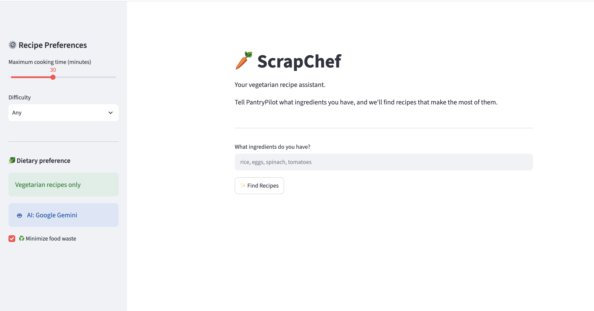

# ScrapChef 🍳

**An AI-powered vegetarian recipe recommendation and meal-planning application that helps users make the most of the ingredients they already have.**

ScrapChef uses the Google Gemini API to generate vegetarian recipes from a user's pantry, then applies custom ingredient-matching, weighted-ranking, and greedy optimization algorithms to recommend meals while minimizing additional grocery purchases.

## Dashboard



## Features

- **AI Recipe Generation:** Generates vegetarian recipe candidates based on user-provided pantry ingredients using the Google Gemini API.
- **Ingredient Normalization:** Standardizes ingredient names to improve matching between user inputs and AI-generated recipes.
- **Weighted Recipe Ranking:** Scores recipes based on pantry match, assigning different weights to main ingredients, secondary ingredients, and common pantry staples.
- **Food Utilization Scoring:** Evaluates how effectively each recipe uses the ingredients already available.
- **Greedy Meal Planning:** Selects multiple recipes while considering ingredient overlap and the additional ingredients each recipe introduces.
- **Shopping List Generation:** Identifies the unique ingredients needed beyond the user's existing pantry.

## How It Works

ScrapChef separates AI-powered recipe generation from algorithmic decision-making.

1. **User Input:** The user enters ingredients currently available in their pantry.
2. **Recipe Generation:** The Gemini API generates structured vegetarian recipe candidates.
3. **Ingredient Processing:** Ingredient names are normalized into consistent representations to improve matching.
4. **Recipe Scoring:** A weighted scoring system evaluates pantry coverage and food utilization.
5. **Meal Optimization:** A greedy algorithm selects recipes sequentially, favoring ingredient reuse and minimizing newly required ingredients.
6. **Shopping List:** The application identifies the unique ingredients the user still needs to purchase.

## Algorithm Design

### Weighted Recipe Ranking

ScrapChef assigns different weights to ingredient categories:

| Ingredient category | Weight |
|---|---:|
| Main ingredients | 3.0 |
| Secondary ingredients | 2.0 |
| Pantry staples | 0.5 |

This allows the recommendation engine to prioritize recipes that use important ingredients already available rather than treating every ingredient equally.

The application also calculates food utilization: the proportion of the user's pantry ingredients used by a recipe.

### Greedy Meal-Planning Algorithm

Selecting the highest-ranked recipes independently does not necessarily produce the most efficient combination of meals. Several individually attractive recipes may require many different grocery purchases.

ScrapChef addresses this by using a greedy selection strategy:

1. Evaluate the available recipe candidates.
2. Select a recipe based on its ingredient value and additional ingredient cost.
3. Update the ingredients covered by the selected meal.
4. Reevaluate the remaining candidates based on their marginal ingredient requirements.
5. Repeat until the requested number of meals is selected.

The algorithm favors recipes that use existing pantry ingredients, reuse ingredients across selected meals, and introduce fewer new ingredients.

**Note:** This is a greedy heuristic, not a guarantee of the globally optimal meal plan.

## Algorithm Evaluation

To evaluate the meal-planning algorithm, I compared three approaches across 100 randomized simulated scenarios:

- **Naive baseline:** Select the first three recipes.
- **Independent ranking:** Rank recipes individually and select the top three.
- **Greedy optimization:** Select recipes sequentially while considering ingredient overlap and marginal ingredient cost.

### Results

Average number of unique ingredients needed to purchase:

| Approach | Average ingredients |
|---|---:|
| Naive baseline | 7.59 |
| Independent ranking | 5.96 |
| Greedy optimization | **5.49** |

The greedy algorithm reduced the average number of unique grocery ingredients by **7.9% compared with independent recipe ranking** across the 100 simulated scenarios.

These results reflect randomized simulations, not measurements from real users.

## Technology Stack

| Category | Technologies |
|---|---|
| Language | Python |
| Application framework | Streamlit |
| AI integration | Google Gemini API |
| AI SDK | Google GenAI Python SDK |
| Data structures | Python lists, sets, dictionaries, dataclasses |
| Algorithms | Ingredient normalization, weighted scoring, greedy optimization |
| Evaluation | Randomized simulations and baseline comparisons |

## Project Structure

```text
ScrapChef/
│
├── streamlit_app.py                  # Streamlit user interface
├── ai_service.py                     # Gemini API integration
├── ai_recipe.py                      # AI recipe generation helpers
├── ingredient_utils.py               # Ingredient normalization and matching
├── ranking.py                        # Recipe scoring and ranking
├── meal_planner.py                   # Greedy meal-planning algorithm
├── recipe.py                         # Recipe data model
│
├── test_ai.py                        # AI-related tests
├── test_real_ai.py                   # Real AI integration test
├── test_weighted_matching.py         # Weighted matching tests
├── test_meal_planner.py               # Meal planner tests
├── test_meal_planner_evaluation.py    # Algorithm evaluation
└── test_randomized_evaluation.py      # Randomized benchmark
```

## Getting Started

### Prerequisites

- Python 3
- A Google Gemini API key from [Google AI Studio](https://aistudio.google.com/)
- Git (optional, for cloning the repository)

### Installation

1. Clone the repository:

```bash
git clone https://github.com/mahima-ram
cd ScrapChef
```

2. Create and activate a virtual environment:

```bash
python3 -m venv .venv
source .venv/bin/activate
```

3. Install the dependencies:

```bash
pip install streamlit google-genai
```

If the project has a `requirements.txt` file, you can instead install all dependencies with:

```bash
pip install -r requirements.txt
```

4. Set your Gemini API key as an environment variable:

```bash
export GEMINI_API_KEY="your_api_key_here"
```

**Important:** Never commit your API key or other secrets to GitHub.

5. Launch the application:

```bash
streamlit run streamlit_app.py
```

The application should open in your browser.

## Future Improvements

- Compare greedy solutions against exact optimal solutions on smaller recipe sets.
- Expand algorithm evaluation with additional randomized scenarios and more realistic ingredient distributions.
- Improve ingredient equivalency and normalization.
- Add user preferences such as dietary restrictions, cooking time, and recipe difficulty.
- Deploy the application so users can access it online.

## What I Learned

Through ScrapChef, I explored how generative AI can be combined with traditional computer science techniques to solve a practical problem. I gained experience with API integration, structured data, data normalization, algorithm design, greedy optimization, and empirical algorithm evaluation.

A central design decision was separating AI-generated recipe candidates from the Python algorithms responsible for evaluating and selecting them.